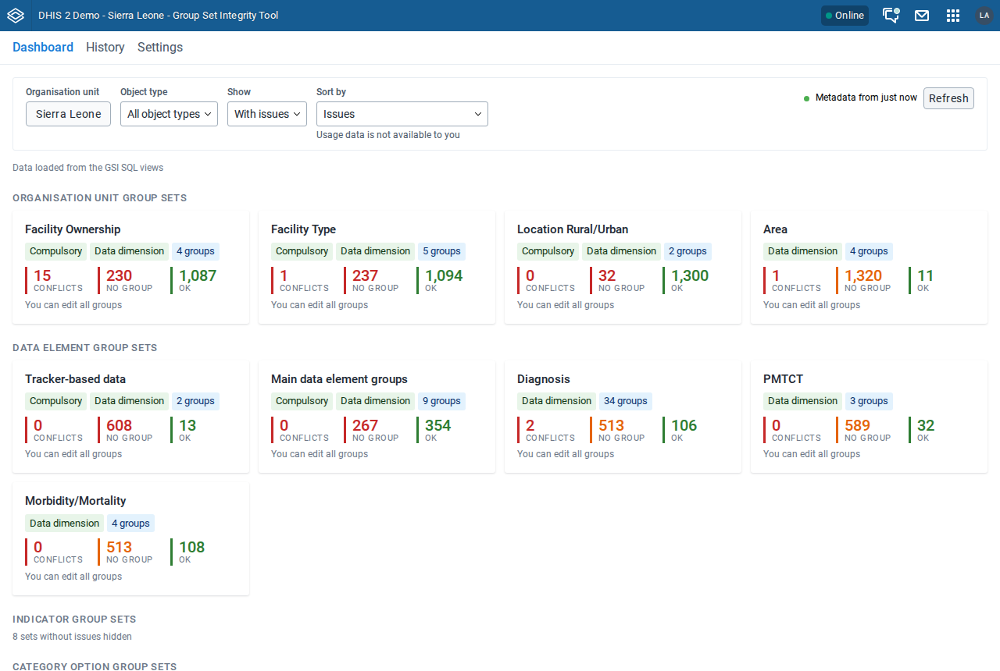
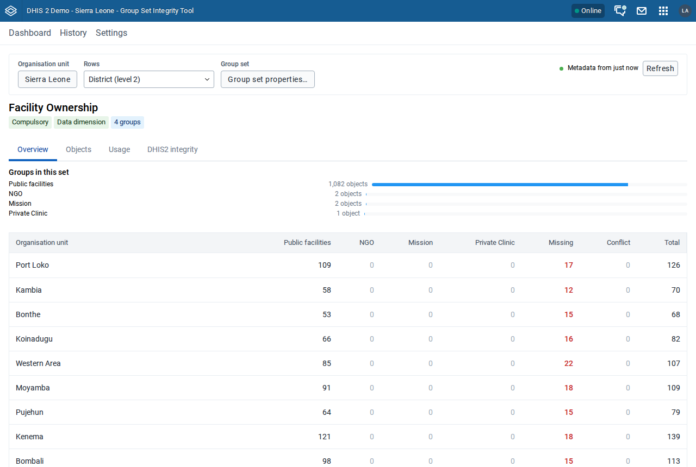
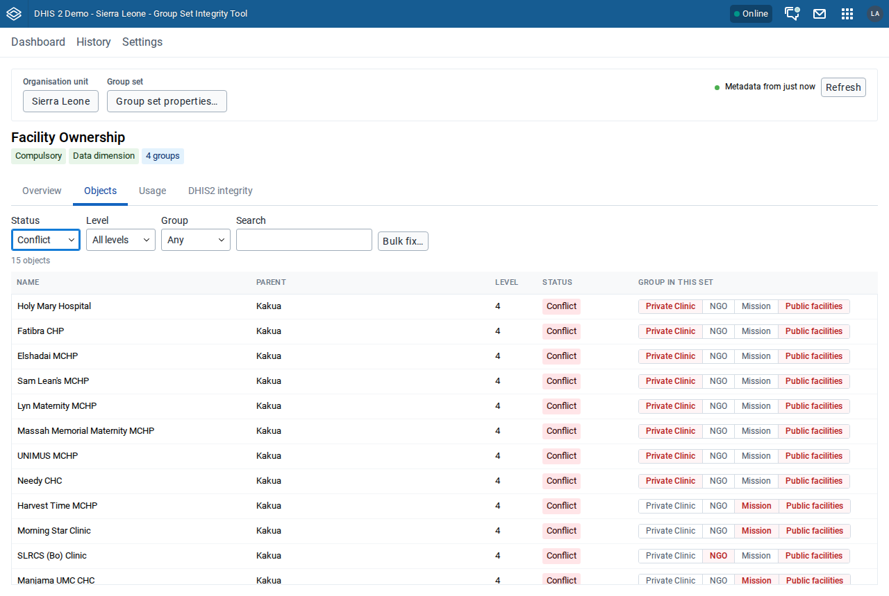
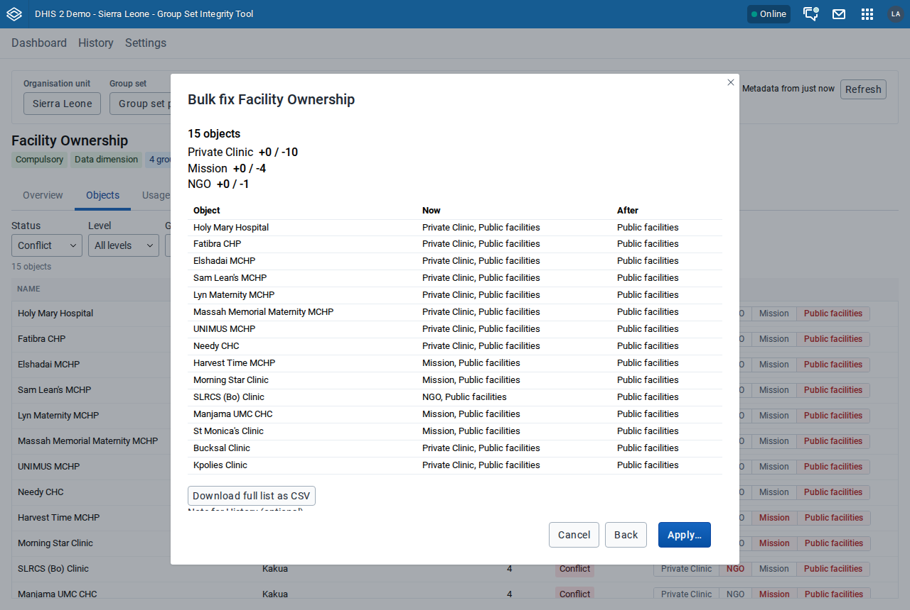
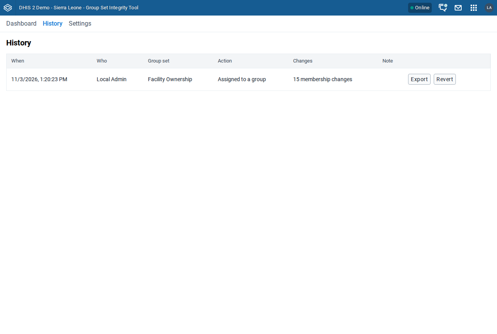
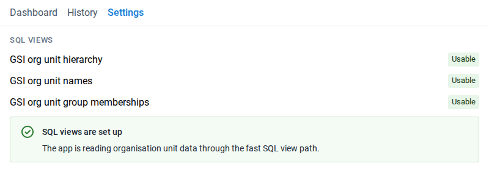

# Group Set Integrity Tool { #tool-group-set-manager-user-guide }

## What the tool is for { #tool-group-set-manager-about }

The Group Set Integrity Tool finds and fixes objects that break the rules of their group sets: objects that are in more than one group of a set, and objects that are in no group of a set that requires one. It is for system administrators and implementers who maintain organisation unit, data element, indicator, and category option group sets.

## Before you start { #tool-group-set-manager-before-you-start }

The tool supports DHIS2 2.40, 2.41, 2.42, and 2.43.

> **Warning**
>
> The tool changes metadata on the server. A bulk fix can move tens of thousands of objects between groups in one action, and Settings can create SQL views and groups. Try the tool on a copy of your database first, and check the result before you use it on a production server.

What you can do in the tool depends on your authorities and on the sharing of each object:

| To do this                                  | You need                                                                      |
| ------------------------------------------- | ----------------------------------------------------------------------------- |
| Open the tool                               | The app in one of your user roles, or the `ALL` authority                     |
| See a group set and its groups              | Metadata read sharing on the group set and its groups                         |
| Fix the membership of an object             | Metadata write sharing on every group that the fix changes                    |
| Change the properties of a group set        | Metadata write sharing on the group set                                       |
| Create a catch-all group in a bulk fix      | The authority to add groups of that type, and write sharing on the group set  |
| Open the **DHIS2 integrity** tab            | `ALL` or `F_PERFORM_MAINTENANCE`                                              |
| Create or repair the SQL views              | `ALL` or `F_SQLVIEW_PUBLIC_ADD`                                               |
| Record changes in History and save settings | Read and write access to the `group-set-integrity` namespace in the dataStore |

<!-- VERIFY IN APP: the exact authority needed to create a group of each type (for example the organisation unit group add authority) for the catch-all group. The app does not check it before it tries; it reports "Could not create the group" on failure. -->

If a group is read-only for you, the tool shows it, and a fix leaves the objects that involve that group as they are.

## Install the tool { #tool-group-set-manager-install }

The tool is not on the App Hub. Install it from its GitHub release, or from the tool-box app.

### Install from the GitHub release { #tool-group-set-manager-install-zip }

1. Open the [releases page of the tool](https://github.com/dhis2-utils/tool-group-set-manager/releases).
2. Under the release that you want to install, download the `.zip` file.
3. In DHIS2, open the **App Management** app.
4. In the sidebar, click **Manual install**.
5. Click **Upload an app to install**, and choose the `.zip` file that you downloaded.

The tool appears in the list of custom apps and in the apps menu as **Group Set Integrity Tool**.

<!-- VERIFY IN APP: App Management labels "Manual install" and "Upload an app to install" on 2.40 to 2.43. -->

### Install from the tool-box app { #tool-group-set-manager-install-toolbox }

1. Open the tool-box app.
2. Find **Group Set Integrity Tool** in the list of tools.
3. Install the tool.

<!-- VERIFY IN APP: the tool-box app's own labels for the tool list and the install action. -->

### Give users access { #tool-group-set-manager-access }

Users who do not have the `ALL` authority can open the tool only when it is in one of their user roles. In the **Users** app, add the tool to the user roles of the people who maintain group sets.

> **Note**
>
> Version 1.0.0 was installed under the app key `group-set-integrity-tool`. DHIS2 treats later versions as a different app. After you install the new version, uninstall the old one in **App Management**, and add the new app to the user roles that had the old one. History, settings, and the SQL views are kept.

## Review the dashboard { #tool-group-set-manager-dashboard }

The dashboard shows one card for each group set, grouped by object type. Each card counts the objects that break the rules of the set, so you can see which sets need work.

1. Open the **Group Set Integrity Tool**. The tool loads the group sets and their members. **Dashboard** opens.
2. In **Organisation unit**, click the button and choose the organisation unit to work in. The counts for organisation unit group sets now cover this organisation unit and every unit below it.
3. In **Object type**, choose a type, or **All object types**.
4. In **Show**, choose **Only sets with issues** or **All sets**.
5. In **Sort by**, choose **Issues** to see the sets with the most errors first.

The tool keeps these choices until you close the browser tab.

### Read the counts { #tool-group-set-manager-counts }

The tool checks each object against each group set in the same way at every organisation unit level:

| What the object is in          | Compulsory set        | Data dimension set    | Other set                             |
| ------------------------------ | --------------------- | --------------------- | ------------------------------------- |
| More than one group of the set | Error (**Conflicts**) | Error (**Conflicts**) | Error (**Conflicts**)                 |
| One group of the set           | **OK**                | **OK**                | **OK**                                |
| No group of the set            | Error (**Missing**)   | Warning (**Missing**) | Allowed (**No group (not required)**) |

A set that is both compulsory and a data dimension follows the **Compulsory** column.

A card shows these items:

- The tags **Compulsory** and **Data dimension**, if they apply, and the number of groups.
- The counts **Conflicts**, **Missing**, and **OK**. A set that is neither compulsory nor a data dimension also shows **No group (not required)**.
- **You can edit all groups**, or the number of groups that are read-only for you.
- If the usage SQL view is installed, the number of favourites that use the set. A set with no favourites shows **Appears unused**. Click it to open the **Usage** tab of the set.

For data element group sets, the tool checks only aggregate data elements, unless you change this in Settings. See [Include tracker data elements](#tool-group-set-manager-tracker).

### Refresh the data { #tool-group-set-manager-refresh }

The tool reads the data from the server when it opens, and keeps a copy in your browser. At the right of the filter bar, the tool shows how old the data is. After 10 minutes, the text changes to say that the data may be out of date.

To read the data from the server again, click **Refresh**. Refresh before you fix anything if other people may have changed groups since you opened the tool.

Under the filter bar, a line shows where the data came from: **Data loaded from the metadata API** or **Data loaded from the GSI SQL views**. On a large instance, set up the SQL views to make loading faster. See [Set up the SQL views for large instances](#tool-group-set-manager-sql-views).

## Inspect a group set { #tool-group-set-manager-inspect }

The page of a group set shows where its problems are and which objects they concern. To open it, click the card of the group set on the dashboard.

The page has four tabs: **Overview**, **Objects**, **Usage**, and **DHIS2 integrity**. The **DHIS2 integrity** tab appears only if you have the `ALL` or `F_PERFORM_MAINTENANCE` authority.

For an organisation unit group set, the filter bar has the same **Organisation unit** control as the dashboard. If you change it here, the dashboard uses the same organisation unit.

### Use the overview matrix { #tool-group-set-manager-overview }

The **Overview** tab shows a matrix of organisation units against the groups of the set. Each row is an organisation unit at the level you choose, and each cell counts the objects in that row's area.

1. On the **Overview** tab, in **Rows**, choose the organisation unit level to show as rows.
2. Click a number in the matrix. The **Objects** tab opens, filtered to the objects behind that number.
3. To go one level down, click the name of an organisation unit in the first column. The tool makes that unit the current organisation unit, and shows the next level as rows.
4. To go back up, click a name in the trail at the left of the filter bar.

The matrix has these columns:

- One column for each group, for up to 8 groups. The other groups are added together in **Other groups**. To choose which groups get their own column, click a number in **Other groups**, choose up to 8 groups, and click **Save**.
- **No group (not required)**, only for a set that is neither compulsory nor a data dimension.
- **Missing**, **Conflict**, and **Total**.

The row **Above the row level** counts the organisation units above the level that you chose in **Rows**. You cannot filter on the numbers in this row.

For data element, indicator, and category option group sets, the matrix has one row, **All objects**.

### List the objects { #tool-group-set-manager-objects }

The **Objects** tab lists the objects of the set, with their status and their group. The list covers the whole current organisation unit, or the area you clicked in the matrix.

1. On the **Objects** tab, in **Status**, choose **All**, **OK**, **Missing**, or **Conflict**.
2. For an organisation unit group set, in **Level**, choose a level, or **All levels**.
3. In **Group**, choose a group, **No group**, **Several groups (conflict)**, or **Any**.
4. In **Search**, enter part of a name.

The number of matching objects shows above the list. The search covers every object that matches the filters, not only the rows on screen.

If you came from a cell of the matrix, the list is limited to one area. To remove this limit, click **Clear area filter**.

### Check how the group set is used { #tool-group-set-manager-usage }

The **Usage** tab shows how many saved favourites use the group set, by type, and how many times they were viewed in the last 12 months. Use it to find group sets that nothing uses any more.

The tab needs the usage SQL view. If it is not installed, the tab shows **Usage data is not installed on this instance**. See [Install the usage SQL view](#tool-group-set-manager-usage-view).

The counts are indicative. They cover saved favourites only. An analytics request from an external client or from the API leaves no favourite behind, so a count of zero does not prove that nothing uses the group set. Indicator group sets are not analytics dimensions, so they have no usage data.

### Compare with the DHIS2 integrity checks { #tool-group-set-manager-integrity }

The **DHIS2 integrity** tab shows the result of the data integrity checks that DHIS2 runs itself, for the type of objects in this set. Use it to compare the count of DHIS2 with the count of the tool.

For each check, the tab shows:

- The number of objects that DHIS2 found, and when the check last ran. DHIS2 counts across the whole instance and across every group set of the type, not only this set.
- How many of those objects are in the current organisation unit.
- The number of objects in this set that the tool finds, within the current organisation unit.

To run the checks again, click **Run now**. On a large instance, the checks can take a minute. Running a check does not change any metadata.

After you fix objects, the tab shows **Stale** next to a result that is older than your change. Run the checks again to update it.

## Fix one object { #tool-group-set-manager-fix-one }

You can move one object to one group of the set from the list of objects. The tool adds the object to the group you choose and removes it from every other group of the set.

1. Open the group set, and click the **Objects** tab.
2. Find the object, for example with **Search** or with **Status** set to **Conflict**.
3. In the **Group in this set** column, choose the group that the object belongs in. If the set has 5 groups or fewer, click the name of the group. If it has more, choose the group from the list.
4. In **Confirm group change**, read which group the object moves to.
5. Click **Assign**.

The tool shows a message that the object is now in the group, and records the change in History.

For an object in conflict, the column shows the groups that the object is in. Choose the group to keep. The tool removes the object from the others.

## Fix many objects with bulk fix { #tool-group-set-manager-bulk-fix }

A bulk fix moves every object that matches the current filter of the **Objects** tab to one group. It shows a preview before it writes anything, and records the change in History so that you can revert it.

The bulk fix has two actions:

- **Move to catch-all group** moves only the objects that are missing or in conflict to one group, for example a group named "Other/unknown". Objects that are already in one group are not changed.
- **Assign all to one group** moves every object that matches the filter to one group, including objects that are already in another group.

> **Warning**
>
> A bulk fix can change the group membership of tens of thousands of objects. **Assign all to one group** also moves objects that are correctly assigned. The tool plans the fix from the data it loaded, so click **Refresh** first if other people may have changed groups since then. Check the filter and the preview before you apply.

### Choose the objects and the action { #tool-group-set-manager-bulk-fix-choose }

1. Open the group set, and click the **Objects** tab.
2. Set **Status**, **Level**, **Group**, and **Search** so that the list shows the objects to fix.
3. Click **Bulk fix…**. The bulk fix dialog opens, with the name of the set in its title.
4. Choose **Move to catch-all group** or **Assign all to one group**.
5. In **Catch-all group** or **Target group**, choose the group to move the objects to.
6. Click **Next**. The preview opens.

For **Move to catch-all group**, the tool suggests the catch-all group from Settings. If there is none, it suggests a group whose name contains "other" or "unknown".

If the set has no such group, you can create one in the dialog:

1. In **Group name** and **Short name**, enter the names of the new group. The short name can have at most 50 characters.
2. Click **Create group**.

DHIS2 creates the group, adds it to the set, and gives it the sharing of another group in the set. The tool chooses it as the catch-all group. This creates metadata on the server, and the tool does not record it in History.

### Preview and apply the bulk fix { #tool-group-set-manager-bulk-fix-apply }

The preview lists, for each group, how many objects the fix adds and removes. A table shows a sample of objects, with their groups now and after the fix.

1. Read the preview. If a group involved is read-only for you, the preview says how many objects the fix skips.
2. To see every object that the fix changes, click **Download full list as CSV**.
3. Optional: in **Note for History (optional)**, enter why you made the change.
4. Click **Apply…**.

The tool writes the changes in batches and shows how many batches it has applied. A fix of tens of thousands of objects can take several minutes. Keep the dialog open until it finishes.

When a group has more than 5,000 changes, the tool first reads the group again from the server. If someone changed the set after the preview, the tool shows **The metadata changed while you were reviewing**, with the number of changes before and now. Click **Review changes** to see the new plan, or click the **Apply** button that shows the new number of changes.

When the fix finishes, the dialog shows the result for each group. Click **Close**.

### Retry changes that failed { #tool-group-set-manager-bulk-fix-retry }

The tool checks each batch against what the server accepted. If the server did not confirm a batch, the result says which group failed.

1. In the result of the bulk fix, read which groups failed.
2. Click **Retry failed changes**.

If a change still fails, click **Refresh** on the dashboard and check the objects in the list.

## Change the properties of a group set { #tool-group-set-manager-properties }

You can turn **Compulsory** and **Data dimension** on or off for a group set from the tool. These properties decide which objects the tool reports as errors.

> **Warning**
>
> This changes the group set on the server. Turning **Data dimension** off removes the set from the dimensions in analytics apps. The tool does not record this change in History, so you cannot revert it from the tool.

1. Open the group set.
2. In the filter bar, click **Group set properties…**.
3. Choose or clear **Compulsory** and **Data dimension**.
4. Click **Save**. The dialog lists what the change does.
5. Click **Confirm**.

The dialog shows **The group set was updated on the server.**, and the tool counts the set again with the new rules.

## Revert a change from History { #tool-group-set-manager-revert }

History lists every membership change made with the tool on this instance, by any user. You can export any change. You can revert a change for 24 hours after it was made; after that, History shows **Can no longer be reverted (older than 24 hours)** instead of the **Revert** button, and the change can still be exported.

The tool works out the revert from the data it loaded. If other people may have changed groups since then, click **Refresh** on the dashboard first.

1. In the navigation bar, click **History**.
2. Find the change in the list. To see older changes, click **Load more**.
3. Optional: to keep a list of the objects that the change touched, click **Export**.
4. Click **Revert**. The **Revert change** dialog shows what the revert changes.
5. Optional: in **Note (optional)**, enter why you revert the change.
6. Click **Revert**.

The dialog shows the result for each group, and History records the revert as a new change. Click **Close**.

The revert skips every object that has moved to another group after the change, and every object whose group has left the set. The preview says how many objects it skips. If every object has moved, the dialog shows **Nothing to revert**.

## Set up the SQL views for large instances { #tool-group-set-manager-sql-views }

On an instance with tens of thousands of organisation units or more, the tool can be slow to load through the metadata API. The tool can instead read the organisation unit hierarchy and the group memberships through three SQL views with codes that start with `GSI_`. On an instance with 266,000 organisation units, this makes the first load take about 45 seconds instead of more than 10 minutes.

You need the `ALL` or `F_SQLVIEW_PUBLIC_ADD` authority.

> **Warning**
>
> The tool shares the SQL views publicly, so that every user can read them. Any logged-in user can then read the organisation unit hierarchy and the organisation unit group memberships through the API, including users who cannot open the tool.

1. In the navigation bar, click **Settings**.
2. Under **SQL views**, check the status of the three views: **Usable**, **Not usable yet**, or **Missing**.
3. If a view is not usable, click **Create SQL views**. The tool creates the missing views and repairs the others.

The tool shows **SQL view update complete** and loads the data again. The dashboard then shows **Data loaded from the GSI SQL views**.

If a SQL view stops working, the tool loads the data through the metadata API and shows **A GSI SQL view failed to load** on the dashboard. Go to **Settings** and click **Create SQL views** to repair it.

The tool does not use a SQL view of the type materialized view, because such a view can return old data.

### Install the usage SQL view { #tool-group-set-manager-usage-view }

The usage SQL view is optional. It counts the saved favourites that use each group set, and how often they were viewed in the last 12 months. The tool shows these counts on the cards and on the **Usage** tab, and lets you sort the dashboard by **Usage (least used first)**.

1. In the navigation bar, click **Settings**.
2. Under **Group set usage**, click **Install usage SQL view**.

The tool shows **Usage data is installed**. To remove the view, click **Remove usage SQL view**.

The usage view is shared in the same way as the other SQL views.

## Configure the settings { #tool-group-set-manager-settings }

The settings in this section apply to every user of the tool on the instance. The tool stores them in the dataStore.

### Choose a catch-all group for a set { #tool-group-set-manager-catch-all }

The catch-all group of a set is the group that **Move to catch-all group** suggests in a bulk fix.

1. In the navigation bar, click **Settings**.
2. Under **Catch-all group**, find the group set.
3. In **Choose catch-all group**, choose the group.

The tool saves the choice at once. To remove it, click **Clear**.

### Include tracker data elements { #tool-group-set-manager-tracker }

By default, the tool checks only aggregate data elements in data element group sets. To check tracker data elements as well:

1. In the navigation bar, click **Settings**.
2. Under **Tracker data**, choose **Include tracker attributes and data elements by default**.

The tool saves the setting at once and counts the data element group sets again.

<!-- VERIFY IN APP: what "tracker attributes" in this label covers. In the code the setting only adds tracker data elements to data element group sets. -->

### Clear the cache { #tool-group-set-manager-cache }

The tool keeps a copy of the data in your browser, so that it opens faster. It uses the copy only when the groups on the server have not changed. If the counts look wrong, clear the copy:

1. In the navigation bar, click **Settings**.
2. Under **Cache**, click **Clear cache**.

The tool deletes the copy in this browser and loads all data from the server again.

## Known limitations { #tool-group-set-manager-limitations }

- **A large bulk fix takes minutes.** Applying a fix to tens of thousands of objects takes several minutes. Most of the time is spent in the DHIS2 endpoint that updates group members, not in the tool.
- **The SQL views are readable by every user.** The `GSI_*` SQL views and the usage SQL view are shared publicly with read access to metadata and data. Any logged-in user can read the organisation unit hierarchy and the organisation unit group memberships through the API, even without access to the tool.
- **Organisation unit names are not translated on the SQL view path.** When the tool loads data through the SQL views, it shows organisation unit names as they are stored, not in your language. The line under the dashboard filter bar says which source the tool used.
- **A bulk fix uses the data that the page loaded.** The tool plans a fix from the data it read when it opened or when you last clicked **Refresh**. It reads a group again from the server only when that group has more than 5,000 changes. If other administrators may be editing the same groups, click **Refresh** before you fix.
- **Only changes from the last 24 hours can be reverted.** An older change stays in History and can be exported, but the tool no longer reverts it, because a revert would undo everything that happened to those objects since.
- **A revert skips objects that have moved.** A revert from History does not change an object that has moved to another group after the original change, or whose group has left the set.
- **History covers only this tool.** History records membership changes made with the tool. It does not record changes made in the **Maintenance** app or through the API, changes to the properties of a group set, or catch-all groups that the tool created.
- **The DHIS2 integrity counts are national.** DHIS2 counts each integrity check across the whole instance and across every group set of the type. The tool cannot ask DHIS2 for a count for one set or one organisation unit.
- **Usage counts are indicative.** They cover saved favourites and their recorded views only. A count of zero does not prove that nothing uses a group set.
- **The row above the row level cannot be filtered.** In the overview matrix, you cannot click the numbers in the **Above the row level** row to list those objects.
- **Read-only groups are skipped.** A fix or revert does not change objects that involve a group that you cannot write to.
